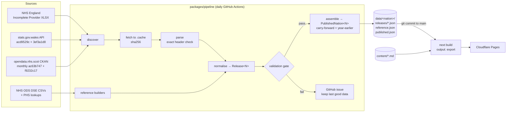

# Know Your Wait — Master plan

**Status:** plan v1, 3 October 2026. **Scope:** v1 per [PRD.md](../../PRD.md), unstyled semantic skeleton (visual design is Phase 11, placeholder).
**Source of truth:** [PRD.md](../../PRD.md), [GLOSSARY.md](../../GLOSSARY.md), [docs/adr/](../adr/). Verified source facts: [data-sources.md](./data-sources.md).

## Blocking findings

Research against live sources (see [data-sources.md § Blocking](./data-sources.md#blocking--prd-contradicting-findings)) found these contradictions with the PRD. The plan already follows the **proposed change** in each case; the product owner should confirm or overrule. No PRD or ADR file has been edited.

| Id      | Finding                                                                                                                                                                 | What the plan does                                                                                                                  | Needs                                                                            |
| ------- | ----------------------------------------------------------------------------------------------------------------------------------------------------------------------- | ----------------------------------------------------------------------------------------------------------------------------------- | -------------------------------------------------------------------------------- |
| **B-1** | Scotland publishes no "% within 12 weeks" for ongoing waits. A percentage needs division, and ADR-0005 allows only exact sums.                                          | Scotland shows a **count**: "{within} of {total} people had waited less than 12 weeks." (Derived exact-sum count + Official total.) | PO: accept, or amend ADR-0005 to allow exact ratios of figures from the same row |
| **B-2** | Scotland data is **monthly** Accredited statistics, not quarterly; Long Wait (`WaitsOver52Weeks`) is published directly, so it is an **Official**, not Derived, Figure. | Ingests monthly files; Long Wait official.                                                                                          | PRD § Data sources / § Figures shown text update                                 |
| **B-3** | Wales withholds the median for ~15 % of board × specialty cells (row absent, no flag).                                                                                  | Shown as Suppressed Figure ("Not published (small numbers)").                                                                       | none                                                                             |
| **B-4** | ADR-0006 assumes a merger yields a new code. ODS shows absorbing trusts keep their code (e.g. RAP→RAL 2025, RVJ→RA7 2026).                                              | Year-Earlier also skipped when a unit received a predecessor in the window (T-3.5, T-7.2).                                          | ADR-0006 consequence note                                                        |
| **B-5** | No official postcode "find your board" tool exists in Wales or Scotland.                                                                                                | Link to official board lists (gov.wales, scot.nhs.uk) labelled "official list of health boards".                                    | PRD wording                                                                      |
| **B-6** | Scotland's 12-week standards are measured on completed waits; we show ongoing waits.                                                                                    | Explainer must say so (T-9.4 skeleton, PO copy).                                                                                    | PO content                                                                       |

## Goal and definition of done

**Goal:** a free, independent, open-source, fully static site that explains official NHS waiting-time statistics for England, Wales and Scotland in plain English, never comparing nations, never estimating, never ranking.

**Done means (PRD):** a user can choose their Home Nation and Specialty, see each Reporting Unit's current figures with source and dates, understand that the figures describe people already waiting and are not a prediction, and read which Patient Rights and processes apply in their nation.

**Done for this plan** (excluding Phase 11): T-10.8 launch checklist complete — all CI green, real data for all three nations, e2e "Done means" journeys pass with and without JavaScript, axe WCAG 2.2 AA clean, PO-reviewed T&O content and explainers, deployed on Cloudflare Pages.

## Architecture

### Packages

| Path                      | Package             | Purpose                                                                                                         |
| ------------------------- | ------------------- | --------------------------------------------------------------------------------------------------------------- |
| `packages/model`          | `@kyw/model`        | Nation-namespaced types + Zod schemas for every glossary concept. No I/O.                                       |
| `packages/pipeline`       | `@kyw/pipeline`     | Per-nation discover → fetch → parse → normalise; reference data; validation gate; assemble published view; CLI. |
| `apps/site`               | `site`              | Next.js App Router, `output: 'export'`; reads committed JSON at build time.                                     |
| `tools/eslint-plugin-kyw` | `eslint-plugin-kyw` | Guardrail lint rules (no ranking by Statistic).                                                                 |
| `content/`                | (files)             | Editorial Content, Markdown + front matter.                                                                     |
| `data/`                   | (files)             | Committed pipeline output — the site's only data source and the public audit trail (ADR-0007).                  |

Why this layout: matches the suggested split; the lint plugin is its own package so rules are testable; `content/` and `data/` sit at the root because both pipeline and site read them.

### Data flow



Each nation runs independently: one nation's failure never blocks or alters another's data.

### Directory layout (target)

```
.
├── AGENTS.md  CLAUDE.md  README.md  LICENSE  DATA-LICENCE.md  CONTRIBUTING.md
├── PRD.md  GLOSSARY.md  docs/{adr,plan,content-brief.md,deploy.md,launch-checklist.md}
├── package.json  pnpm-workspace.yaml  tsconfig.base.json  eslint.config.js  vitest.config.ts
├── .github/{workflows/{ci,pipeline,deploy,links,labels}.yml, ISSUE_TEMPLATE/, scripts/}
├── packages/
│   ├── model/src/{nation,ids,period,figure,source,release,nation-definitions,reference,published}.ts
│   │            {england,wales,scotland}/{definitions,schema}.ts
│   └── pipeline/src/{cli,run,source,errors,backfill}.ts
│                  {http,io,validate,assemble,content}/
│                  reference/{ods,england,wales,scotland}/
│                  {england,wales,scotland}/{discover,parse,columns,normalise,source}.ts
│                fixtures/{england,wales,scotland,ods}/   scripts/   test/
├── tools/eslint-plugin-kyw/
├── data/{england,wales,scotland}/{reference.json,published.json,state.json,releases/}
├── content/{england,wales,scotland}/{about-the-figures.md,your-rights.md,specialties/}
└── apps/site/
    ├── src/app/{page.tsx,layout.tsx,not-found.tsx,about,sources,privacy,accessibility}
    │          {england,wales,scotland}/{page.tsx,[specialty]/page.tsx,[specialty]/[unit]/page.tsx,
    │                                   about-the-figures/page.tsx,your-rights/page.tsx}
    ├── src/{components,nations/{england,wales,scotland},data,i18n,content,config}/
    ├── messages/en/<namespace>.json
    ├── e2e/  test/  public/{_headers,_redirects}
```

### Key type design (ADR-0006)

- Every domain type takes `N extends PublishingNation`, wrapped with `SingleNation<N>` so `Figure<'england' | 'wales'>` resolves to `never`. A cross-nation array, join or ranking does not type-check.
- Ids are branded template literals: `` `england:${string}` `` + brand, separate per kind (Reporting Unit, Specialty, Wait Stage, Statistic, Hospital Site).
- `FigureValue` has **no `value` key** when suppressed, so a Suppressed Figure cannot be rendered as `0`.
- `Provenance` = official (source field) | derived (`exact-sum` + input fields). `exactSum` returns `null` on any suppressed/missing/mismatched input.
- `ReportingPeriod` and `PublicationDate` are distinct branded types.
- The site only reads `PublishedNation<N>` (precomputed carry-forward and year-earlier state).

## Phases

| #   | Phase                                                                   | Summary                                                                                                                                                                                                                                   | Tasks |
| --- | ----------------------------------------------------------------------- | ----------------------------------------------------------------------------------------------------------------------------------------------------------------------------------------------------------------------------------------- | ----- |
| 1   | [Repo foundation](./phase-01-repo-foundation.md)                        | git, pnpm workspace with all shared dev tooling, strict TS, ESLint/Prettier, Vitest (incl. type tests), CI, MIT + OGL data notice, `AGENTS.md` drafted in full.                                                                           | 8     |
| 2   | [Domain model](./phase-02-domain-model.md)                              | Nation-namespaced ids, periods, figure values/status/provenance, Release + compact file form, per-nation definitions, reference and published-view types, type-level guardrail suite, guardrail ESLint plugin.                            | 11    |
| 3   | [Pipeline foundations and reference data](./phase-03-reference-data.md) | Fetch/cache/canonical JSON/data layout/source-adapter interface; ODS client; England regions, units, Hospital Sites, succession, Specialties; Wales crosswalk; Scotland boards and hospitals.                                             | 9     |
| 4   | [Pipeline: England](./phase-04-pipeline-england.md)                     | Trimmed real fixtures, link discovery from yearly pages (incl. `-revised`), XLSX parse with exact header checks, normalise, adapter.                                                                                                      | 5     |
| 5   | [Pipeline: Wales](./phase-05-pipeline-wales.md)                         | stats.gov.wales coded downloads, version-based discovery, parse, normalise with same-release year-earlier medians, adapter.                                                                                                               | 5     |
| 6   | [Pipeline: Scotland](./phase-06-pipeline-scotland.md)                   | CKAN discovery, QF flag decoding, two Wait Stages, days, Derived within-12 count, band integrity checks, adapter.                                                                                                                         | 5     |
| 7   | [Validation and scheduling](./phase-07-validation-and-scheduling.md)    | Validation gate with tunable thresholds, Year-Earlier and Carried-Forward logic, published-view assembly, CLI, daily workflow (commit / issue), backfill and first real data.                                                             | 7     |
| 8   | [Site skeleton](./phase-08-site-skeleton.md)                            | Static Next.js scaffold, validated data loader, i18n layer, layout/footer, home + border notice, figure primitives with exact wording, per-nation statements and routes, progressive filter, static pages, wording and no-ranking guards. | 17    |
| 9   | [Editorial Content](./phase-09-editorial-content.md)                    | Content schema/loader, Specialty stubs, T&O structure, explainer pages, freshness/launch gates, PO content brief. Agents write structure only.                                                                                            | 6     |
| 10  | [Quality and launch](./phase-10-quality-and-launch.md)                  | Playwright + axe on the static export (JS and no-JS), journeys, output scan, a11y, Cloudflare Pages deploy + headers + analytics, issue forms, link checker, launch checklist.                                                            | 8     |
| 11  | [Visual design (placeholder)](./phase-11-visual-design-placeholder.md)  | Stub only; slots in later without restructuring.                                                                                                                                                                                          | 0     |

**Total: 81 tasks in 10 planned phases (+1 placeholder).** Phases 4, 5 and 6 run in parallel once Phase 2 definitions and T-3.1 land (Wales/Scotland normalise also need T-3.7/T-3.8).

## Conventions

Every task assumes the agent has read `AGENTS.md`, `GLOSSARY.md`, the cited ADRs and the task.

1. **One task = one branch = one PR.** Branch `t-<phase>-<n>-<slug>`; PR title `T-x.y — <title>`; Conventional Commits.
2. **File ownership.** A task edits only the files in its **Owns files** list. Two tasks marked parallel-safe never own the same file.
3. **Shared append-only files.** These are edited by several (sequential or parallel) tasks and are the only exception to rule 2: `pnpm-lock.yaml`, `package.json` `dependencies`/`devDependencies`/`scripts` sections, `.github/workflows/ci.yml` (each task appends its own job), `eslint.config.js` (each task appends its own clearly commented block). On conflict: rebase on `main`, keep both sides, rerun `pnpm install`.
4. **i18n messages** are split per namespace (`apps/site/messages/en/<namespace>.json`), each owned by one task.
5. **Nation isolation.** Nation-specific code lives in `…/england/`, `…/wales/`, `…/scotland/` folders; lint zones forbid cross-imports (T-2.11). Generic code takes one `N` type parameter and never two nations.
6. **Tests.** Vitest unit + type tests (`*.test-d.ts`); pipeline tests use **real** source files trimmed into `packages/pipeline/fixtures/`, no network. Figure-rendering tests assert exact wording, caption, Reporting Period vs Publication Date, and status labels.
7. **Task done** = acceptance criteria met; `pnpm format:check && pnpm lint && pnpm typecheck && pnpm test` green (plus site build/e2e once they exist); PR merged.
8. **`data/`** is written only by the pipeline, never by hand.
9. **Uncertainty.** If a source or doc contradicts the task, stop and report; don't silently change a decision.

## Dependency graph

```mermaid
flowchart LR
  subgraph P1["Phase 1: Repo foundation"]
    T1_1["T-1.1"]
    T1_2["T-1.2"]
    T1_3["T-1.3"]
    T1_4["T-1.4"]
    T1_5["T-1.5"]
    T1_6["T-1.6"]
    T1_7["T-1.7"]
    T1_8["T-1.8"]
  end
  subgraph P2["Phase 2: Domain model"]
    T2_1["T-2.1"]
    T2_2["T-2.2"]
    T2_3["T-2.3"]
    T2_4["T-2.4"]
    T2_5["T-2.5"]
    T2_6["T-2.6"]
    T2_7["T-2.7"]
    T2_8["T-2.8"]
    T2_9["T-2.9"]
    T2_10["T-2.10"]
    T2_11["T-2.11"]
  end
  subgraph P3["Phase 3: Reference data"]
    T3_1["T-3.1"]
    T3_2["T-3.2"]
    T3_3["T-3.3"]
    T3_4["T-3.4"]
    T3_5["T-3.5"]
    T3_6["T-3.6"]
    T3_7["T-3.7"]
    T3_8["T-3.8"]
    T3_9["T-3.9"]
  end
  subgraph P4["Phase 4: Pipeline England"]
    T4_1["T-4.1"]
    T4_2["T-4.2"]
    T4_3["T-4.3"]
    T4_4["T-4.4"]
    T4_5["T-4.5"]
  end
  subgraph P5["Phase 5: Pipeline Wales"]
    T5_1["T-5.1"]
    T5_2["T-5.2"]
    T5_3["T-5.3"]
    T5_4["T-5.4"]
    T5_5["T-5.5"]
  end
  subgraph P6["Phase 6: Pipeline Scotland"]
    T6_1["T-6.1"]
    T6_2["T-6.2"]
    T6_3["T-6.3"]
    T6_4["T-6.4"]
    T6_5["T-6.5"]
  end
  subgraph P7["Phase 7: Validation and scheduling"]
    T7_1["T-7.1"]
    T7_2["T-7.2"]
    T7_3["T-7.3"]
    T7_4["T-7.4"]
    T7_5["T-7.5"]
    T7_6["T-7.6"]
    T7_7["T-7.7"]
  end
  subgraph P8["Phase 8: Site skeleton"]
    T8_1["T-8.1"]
    T8_2["T-8.2"]
    T8_3["T-8.3"]
    T8_4["T-8.4"]
    T8_5["T-8.5"]
    T8_6["T-8.6"]
    T8_7["T-8.7"]
    T8_8["T-8.8"]
    T8_9["T-8.9"]
    T8_10["T-8.10"]
    T8_11["T-8.11"]
    T8_12["T-8.12"]
    T8_13["T-8.13"]
    T8_14["T-8.14"]
    T8_15["T-8.15"]
    T8_16["T-8.16"]
    T8_17["T-8.17"]
  end
  subgraph P9["Phase 9: Editorial Content"]
    T9_1["T-9.1"]
    T9_2["T-9.2"]
    T9_3["T-9.3"]
    T9_4["T-9.4"]
    T9_5["T-9.5"]
    T9_6["T-9.6"]
  end
  subgraph P10["Phase 10: Quality and launch"]
    T10_1["T-10.1"]
    T10_2["T-10.2"]
    T10_3["T-10.3"]
    T10_4["T-10.4"]
    T10_5["T-10.5"]
    T10_6["T-10.6"]
    T10_7["T-10.7"]
    T10_8["T-10.8"]
  end
  T1_1 --> T1_2
  T1_2 --> T1_3
  T1_2 --> T1_4
  T1_2 --> T1_5
  T1_3 --> T1_6
  T1_4 --> T1_6
  T1_5 --> T1_6
  T1_1 --> T1_7
  T1_1 --> T1_8
  T1_3 --> T2_1
  T1_5 --> T2_1
  T1_3 --> T2_2
  T1_5 --> T2_2
  T2_1 --> T2_3
  T2_2 --> T2_3
  T2_3 --> T2_4
  T2_4 --> T2_5
  T2_4 --> T2_6
  T2_4 --> T2_7
  T2_1 --> T2_8
  T2_4 --> T2_9
  T2_8 --> T2_9
  T2_5 --> T2_10
  T2_6 --> T2_10
  T2_7 --> T2_10
  T2_9 --> T2_10
  T1_4 --> T2_11
  T1_2 --> T3_1
  T1_3 --> T3_1
  T1_5 --> T3_1
  T2_4 --> T3_1
  T3_1 --> T3_2
  T2_8 --> T3_3
  T3_1 --> T3_3
  T3_2 --> T3_4
  T3_3 --> T3_4
  T3_2 --> T3_5
  T2_8 --> T3_6
  T3_1 --> T3_6
  T3_1 --> T3_7
  T3_2 --> T3_7
  T2_8 --> T3_7
  T3_1 --> T3_8
  T2_8 --> T3_8
  T3_4 --> T3_9
  T3_5 --> T3_9
  T3_6 --> T3_9
  T4_3 --> T3_9
  T3_1 --> T4_1
  T3_1 --> T4_2
  T4_1 --> T4_2
  T4_1 --> T4_3
  T3_1 --> T4_3
  T4_3 --> T4_4
  T2_5 --> T4_4
  T3_6 --> T4_4
  T4_2 --> T4_5
  T4_4 --> T4_5
  T3_9 --> T4_5
  T3_1 --> T5_1
  T3_1 --> T5_2
  T5_1 --> T5_3
  T5_2 --> T5_3
  T5_3 --> T5_4
  T2_6 --> T5_4
  T3_7 --> T5_4
  T5_2 --> T5_5
  T5_4 --> T5_5
  T3_1 --> T6_1
  T3_1 --> T6_2
  T6_1 --> T6_3
  T6_3 --> T6_4
  T2_7 --> T6_4
  T3_8 --> T6_4
  T6_2 --> T6_5
  T6_4 --> T6_5
  T2_4 --> T7_1
  T2_5 --> T7_1
  T2_6 --> T7_1
  T2_7 --> T7_1
  T3_1 --> T7_1
  T2_9 --> T7_2
  T3_5 --> T7_2
  T2_9 --> T7_3
  T7_2 --> T7_4
  T7_3 --> T7_4
  T7_1 --> T7_5
  T7_4 --> T7_5
  T4_5 --> T7_5
  T5_5 --> T7_5
  T6_5 --> T7_5
  T7_5 --> T7_6
  T10_6 --> T7_6
  T1_6 --> T7_6
  T7_5 --> T7_7
  T1_6 --> T8_1
  T8_1 --> T8_2
  T2_9 --> T8_2
  T2_8 --> T8_2
  T3_1 --> T8_2
  T8_1 --> T8_3
  T8_3 --> T8_4
  T8_4 --> T8_5
  T8_3 --> T8_6
  T2_9 --> T8_6
  T8_6 --> T8_7
  T2_5 --> T8_7
  T8_6 --> T8_8
  T2_6 --> T8_8
  T8_6 --> T8_9
  T2_7 --> T8_9
  T8_3 --> T8_10
  T8_2 --> T8_11
  T8_5 --> T8_11
  T8_10 --> T8_11
  T9_2 --> T8_11
  T8_2 --> T8_12
  T8_7 --> T8_12
  T8_2 --> T8_13
  T8_5 --> T8_13
  T8_8 --> T8_13
  T8_10 --> T8_13
  T9_2 --> T8_13
  T8_2 --> T8_14
  T8_5 --> T8_14
  T8_9 --> T8_14
  T8_10 --> T8_14
  T9_2 --> T8_14
  T8_4 --> T8_15
  T8_7 --> T8_16
  T8_8 --> T8_16
  T8_9 --> T8_16
  T8_15 --> T8_16
  T9_1 --> T8_16
  T8_11 --> T8_17
  T8_13 --> T8_17
  T8_14 --> T8_17
  T8_1 --> T9_1
  T2_8 --> T9_1
  T9_1 --> T9_2
  T3_6 --> T9_2
  T3_7 --> T9_2
  T3_8 --> T9_2
  T9_2 --> T9_3
  T9_1 --> T9_4
  T8_4 --> T9_4
  T8_5 --> T9_4
  T9_1 --> T9_5
  T8_1 --> T10_1
  T10_1 --> T10_2
  T8_12 --> T10_2
  T8_13 --> T10_2
  T8_14 --> T10_2
  T9_4 --> T10_2
  T8_12 --> T10_3
  T8_13 --> T10_3
  T8_14 --> T10_3
  T8_16 --> T10_3
  T10_1 --> T10_4
  T8_12 --> T10_4
  T8_13 --> T10_4
  T8_14 --> T10_4
  T8_15 --> T10_4
  T9_4 --> T10_4
  T8_4 --> T10_5
  T10_1 --> T10_5
  T1_6 --> T10_6
  T8_15 --> T10_7
  T9_1 --> T10_7
  T10_2 --> T10_8
  T10_3 --> T10_8
  T10_4 --> T10_8
  T10_5 --> T10_8
  T9_5 --> T10_8
  T7_7 --> T10_8
```



## Parallel waves

Tasks in the same wave have all dependencies in earlier waves and can run at the same time (check **Owns files**; none overlap within a wave).

| Wave | Tasks                                                                                                                    |
| ---- | ------------------------------------------------------------------------------------------------------------------------ |
| 0    | T-1.1, T-9.6                                                                                                             |
| 1    | T-1.2, T-1.7, T-1.8                                                                                                      |
| 2    | T-1.3, T-1.4, T-1.5                                                                                                      |
| 3    | T-1.6, T-2.1, T-2.2, T-2.11                                                                                              |
| 4    | T-2.3, T-2.8, T-8.1, T-10.6                                                                                              |
| 5    | T-2.4, T-8.3, T-9.1, T-10.1                                                                                              |
| 6    | T-2.5, T-2.6, T-2.7, T-2.9, T-3.1, T-8.4, T-8.10, T-9.5                                                                  |
| 7    | T-2.10, T-3.2, T-3.3, T-3.6, T-3.8, T-4.1, T-5.1, T-5.2, T-6.1, T-6.2, T-7.1, T-7.3, T-8.2, T-8.5, T-8.6, T-8.15, T-10.5 |
| 8    | T-3.4, T-3.5, T-3.7, T-4.2, T-4.3, T-5.3, T-6.3, T-8.7, T-8.8, T-8.9, T-9.4, T-10.7                                      |
| 9    | T-3.9, T-4.4, T-5.4, T-6.4, T-7.2, T-8.12, T-8.16, T-9.2                                                                 |
| 10   | T-4.5, T-5.5, T-6.5, T-7.4, T-8.11, T-8.13, T-8.14, T-9.3                                                                |
| 11   | T-7.5, T-8.17, T-10.2, T-10.3, T-10.4                                                                                    |
| 12   | T-7.6, T-7.7                                                                                                             |
| 13   | T-10.8                                                                                                                   |

**Critical path:** T-1.1 → T-1.2 → T-1.3 → T-2.1 → T-2.3 → T-2.4 → T-3.1 → T-4.1 → T-4.3 → T-4.4 → T-4.5 → T-7.5 → T-7.7 → T-10.8. Product-owner copy (T-9.6 brief → content) runs alongside and gates T-10.8.

## Assumptions

Defaults chosen where the docs were silent. Each can be changed by the product owner; the owning task is listed.

| Id   | Assumption                                                                                                                                                                                                            | Task                   |
| ---- | --------------------------------------------------------------------------------------------------------------------------------------------------------------------------------------------------------------------- | ---------------------- |
| A-01 | GitHub repo, Cloudflare account/Pages project, domain and contact email are created by the product owner; placeholders in `apps/site/src/config/site.ts` until then.                                                  | T-1.1, T-8.4, T-10.5   |
| A-02 | Node 24 LTS in CI (`.nvmrc`), pnpm 10 via corepack.                                                                                                                                                                   | T-1.1, T-1.2           |
| A-03 | Package layout as in § Architecture, plus `tools/eslint-plugin-kyw`; internal packages consumed as TS source (no build step).                                                                                         | T-1.2                  |
| A-04 | **Zod v4** for runtime validation; hand-written types where branding/nation generics need it, with type tests tying schema output to types.                                                                           | T-2.x                  |
| A-05 | Validation thresholds: England units ≥ 95 % of previous; Wales/Scotland any missing board blocks; figures ≥ 90 % of previous; nation total-waiting swing ≤ 25 %; plus schema, date and consistency checks.            | T-7.1                  |
| A-06 | Small custom i18n layer on `intl-messageformat` (no `next-intl`, no locale routing) because the site is a static export in one language; messages per namespace.                                                      | T-8.3                  |
| A-07 | `no-recent-figures` entries are dropped from pages 24 months after the last Reporting Period.                                                                                                                         | T-7.3                  |
| A-08 | Median display: England/Wales published weeks rounded to 1 dp (England publishes ~13 dp); Scotland days rounded to whole days and weeks to whole weeks with "about". Stored values unchanged.                         | T-8.3, T-8.7–T-8.9     |
| A-09 | "% within" wording: "About 7 in 10 (65.0%) had waited less than 18 weeks." — natural frequency rounded to nearest 10, "About" unless exact, exact percent in brackets.                                                | T-8.7, T-8.8           |
| A-10 | Scotland Publication Date = date of the CKAN resource `last_modified`.                                                                                                                                                | T-6.2                  |
| A-11 | Scotland `S27000001` "Non-NHS Provider/Location" is an aggregate, not an organisation a patient can choose, so it is **not** a Reporting Unit (ADR-0003 concerns named Independent Sector Providers). PO to confirm.  | T-3.8, T-6.4           |
| A-12 | England Hospital Sites = open ODS sites of the unit, excluding RO31 ePACT, filtered by hospital-like names or RO29/RO320 sub-types; a site-level ISP code is its own single site. PO may replace with a curated list. | T-3.4                  |
| A-13 | Wales: a missing count row where the cell's total exists = 0 (verified against band sums); a missing median = Suppressed. Confirm with stats.healthinfo@gov.wales.                                                    | T-5.4                  |
| A-14 | Wales and Scotland backfill prior months from the current vintage, marked `backfilled` in `state.json`.                                                                                                               | T-7.7                  |
| A-15 | Reporting Unit URL segment = lower-case official code (`/england/trauma-and-orthopaedics/rrk`).                                                                                                                       | T-8.12–T-8.14          |
| A-16 | Specialty slugs are hand-written per nation and permanent; each nation's "all specialties" entry gets its own page, listed last. England's official name for it is "Total" — displayed as "All specialties".          | T-3.6–T-3.8            |
| A-17 | `exceljs` for XLSX (cached formula results), `csv-parse` for CSV, `yauzl-promise` reserved for ZIP if ever needed.                                                                                                    | T-1.2, T-3.1           |
| A-18 | Code MIT; data and reference data OGL v3 with attributions in `DATA-LICENCE.md` and `/sources`.                                                                                                                       | T-1.7, T-8.15          |
| A-19 | Data commits go straight to `main` from the bot (no PR), as ADR-0007 describes; deploy runs after CI passes.                                                                                                          | T-7.6, T-10.5          |
| A-20 | Reporting Unit lists show only units with an entry (current, carried-forward or no-recent) for that Specialty, and show no figures, so lists can't read as rankings.                                                  | T-8.11, T-8.13, T-8.14 |
| A-21 | Explainer routes are `/<nation>/about-the-figures` and `/<nation>/your-rights`; these slugs are reserved against Specialty slugs.                                                                                     | T-3.6, T-9.4           |
| A-22 | Cloudflare Web Analytics beacon is loaded without SRI because Cloudflare serves a versionless script; CSP restricts it to `static.cloudflareinsights.com`.                                                            | T-10.5                 |

## Risks and mitigations

| Risk                                                                            | Mitigation                                                                                                                      |
| ------------------------------------------------------------------------------- | ------------------------------------------------------------------------------------------------------------------------------- |
| Source format changes (headers, URLs, codes)                                    | Exact header/code checks raise `SchemaChangeError`; gate blocks; issue opened; site keeps last good data (T-3.1, T-7.1, T-7.6). |
| Silent revisions (Wales, Scotland) make month-to-month comparisons inconsistent | Year-earlier medians from the **same** download (`comparisonFigures`); each release stores source sha256 and version ids.       |
| England links unpredictable; revised files replace links                        | Scrape yearly pages each run; URL change for an existing period = revision (T-4.2, T-4.5).                                      |
| ORD API deprecation; FHIR API needs a key                                       | Use key-free DSE bulk CSVs; ORD only for Welsh site listing, fixture-backed (T-3.2, T-3.7).                                     |
| NHS England organisational change moves statistics pages                        | Discovery fails loudly → issue; URL constants isolated in `england/discover.ts`.                                                |
| PHS review changes frequency/content                                            | Discovery keyed on resource ids; missing id → `SourceUnavailableError` issue.                                                   |
| Users read figures as predictions or rankings                                   | Fixed caption on every figure; no figures in lists; alphabetical order enforced by lint + tests; output scan.                   |
| Accidental cross-nation comparison by future code                               | `SingleNation` types, guardrail type tests, lint zones, output leak scan (T-2.10, T-2.11, T-10.3).                              |
| Rounding wording (A-08/A-09) could overstate precision or mislead               | Exact percent shown alongside; PO review before launch.                                                                         |
| Repo growth from committed JSON                                                 | Compact file form; England release ≤ 5 MB target (T-2.4); raw downloads never committed.                                        |
| Product owner copy not ready                                                    | Placeholders render nothing invented; launch gate script blocks launch (T-9.5, T-10.8).                                         |
| NHS identity guidance (PRD open question)                                       | Checked in launch checklist; no NHS marks anywhere; output scan (T-10.3, T-10.8).                                               |
| Scotland "Non-NHS Provider" exclusion conflicts with ADR-0003 spirit            | Flagged as A-11 for PO decision.                                                                                                |

## Open questions carried from the PRD

| PRD open question                  | Status                                                                                |
| ---------------------------------- | ------------------------------------------------------------------------------------- |
| PHS monthly management information | **Resolved:** monthly open data are Accredited official statistics (data-sources.md). |
| Validation thresholds              | Defaults in A-05, tunable in `thresholds.ts`.                                         |
| Structure of explainers            | Skeleton in T-9.4; copy by PO.                                                        |
| NHS identity guidance              | Launch checklist T-10.8.                                                              |
| Welsh-language reviewer            | Out of v1; Welsh labels available via `?lang=cy` (data-sources.md).                   |

## TODO checklist

### [Phase 1 — Repo foundation](./phase-01-repo-foundation.md)

- [ ] T-1.1 — Initialise the git repository and base repo files
- [ ] T-1.2 — Create the pnpm workspace and install all shared dev tooling
- [ ] T-1.3 — Configure strict TypeScript for all packages
- [ ] T-1.4 — Configure ESLint (flat config) and Prettier
- [ ] T-1.5 — Configure Vitest for the workspace
- [ ] T-1.6 — Add the CI workflow for pull requests
- [ ] T-1.7 — Add the code licence, data licence notice and contribution basics
- [ ] T-1.8 — Write AGENTS.md, the rulebook for building agents

### [Phase 2 — Domain model](./phase-02-domain-model.md)

- [ ] T-2.1 — Define Publishing Nations and nation-namespaced identifiers
- [ ] T-2.2 — Define Reporting Period and Publication Date
- [ ] T-2.3 — Define figure values, status, unit and provenance
- [ ] T-2.4 — Define the Release type and the per-nation schema factory
- [ ] T-2.5 — Define England's Wait Stage, Statistics and Waiting Standard
- [ ] T-2.6 — Define Wales's Wait Stage, Statistics and Waiting Standard
- [ ] T-2.7 — Define Scotland's two Wait Stages, Statistics and Waiting Standards
- [ ] T-2.8 — Define reference data types: Reporting Units, Hospital Sites, NHS Regions, Specialties, succession
- [ ] T-2.9 — Define the published view the site reads (carried-forward and year-earlier state)
- [ ] T-2.10 — Add the cross-nation guardrail type-test suite
- [ ] T-2.11 — Add the project guardrail ESLint plugin (no ranking, no cross-nation imports)

### [Phase 3 — Pipeline foundations and reference data](./phase-03-reference-data.md)

- [ ] T-3.1 — Pipeline foundations: fetch, cache, canonical JSON, data layout, source-adapter interface
- [ ] T-3.2 — ODS bulk CSV client with trimmed real fixtures
- [ ] T-3.3 — England NHS Regions with display names
- [ ] T-3.4 — England Reporting Units and Hospital Sites builder
- [ ] T-3.5 — England succession map and Year-Earlier eligibility
- [ ] T-3.6 — England Specialty list and slugs
- [ ] T-3.7 — Wales reference data: health boards, crosswalk, sites, Specialties
- [ ] T-3.8 — Scotland reference data: boards, Golden Jubilee, hospital sites, Specialties
- [ ] T-3.9 — Assemble and write England reference data

### [Phase 4 — Pipeline: England ingest and normalise](./phase-04-pipeline-england.md)

- [ ] T-4.1 — Commit trimmed real England fixtures
- [ ] T-4.2 — Discover England release files from the yearly pages
- [ ] T-4.3 — Parse the Incomplete Provider XLSX
- [ ] T-4.4 — Normalise parsed rows into `Release<'england'>`
- [ ] T-4.5 — England source adapter

### [Phase 5 — Pipeline: Wales ingest and normalise](./phase-05-pipeline-wales.md)

- [ ] T-5.1 — Commit trimmed real Wales fixtures
- [ ] T-5.2 — Wales API client and release discovery
- [ ] T-5.3 — Parse Wales coded CSVs
- [ ] T-5.4 — Normalise into `Release<'wales'>` (with same-release year-earlier medians)
- [ ] T-5.5 — Wales source adapter

### [Phase 6 — Pipeline: Scotland ingest and normalise](./phase-06-pipeline-scotland.md)

- [ ] T-6.1 — Commit trimmed real Scotland fixtures
- [ ] T-6.2 — Scotland release discovery via CKAN
- [ ] T-6.3 — Parse monthly CSVs and decode quality flags
- [ ] T-6.4 — Normalise into `Release<'scotland'>` (two Wait Stages, days, Derived within-12 count)
- [ ] T-6.5 — Scotland source adapter

### [Phase 7 — Validation gate, publish logic and scheduled pipeline](./phase-07-validation-and-scheduling.md)

- [ ] T-7.1 — Validation gate
- [ ] T-7.2 — Year-Earlier Comparison logic
- [ ] T-7.3 — Carried-Forward logic
- [ ] T-7.4 — Assemble `published.json` per nation
- [ ] T-7.5 — Pipeline CLI orchestrator
- [ ] T-7.6 — Scheduled GitHub Actions pipeline workflow
- [ ] T-7.7 — Backfill history and commit the first real data

### [Phase 8 — Site skeleton (unstyled, semantic)](./phase-08-site-skeleton.md)

- [ ] T-8.1 — Scaffold the Next.js static site
- [ ] T-8.2 — Build-time data loader with validation
- [ ] T-8.3 — Build the i18n layer and date/number formatting
- [ ] T-8.4 — Root layout, footer, skip link and "Spotted a mistake?" link
- [ ] T-8.5 — Home page and the border notice
- [ ] T-8.6 — Shared figure primitives: caption, source line, status labels
- [ ] T-8.7 — England figure statements
- [ ] T-8.8 — Wales figure statements
- [ ] T-8.9 — Scotland figure statements (two Wait Stages, days)
- [ ] T-8.10 — Progressive-enhancement list filter
- [ ] T-8.11 — England Specialty list and Reporting Unit list pages
- [ ] T-8.12 — England Reporting Unit detail page
- [ ] T-8.13 — Wales routes: Specialty list, health board list, detail
- [ ] T-8.14 — Scotland routes: Specialty list, health board list, detail
- [ ] T-8.15 — Static information pages: about, sources and licences, privacy, accessibility
- [ ] T-8.16 — Wording guard tests: _Avoid_ terms and required captions
- [ ] T-8.17 — 404 page, robots, sitemap and no-ranking order tests

### [Phase 9 — Editorial Content structure](./phase-09-editorial-content.md)

- [ ] T-9.1 — Content schema, loader and Markdown rendering
- [ ] T-9.2 — Generate Specialty description stubs for every nation
- [ ] T-9.3 — Trauma & Orthopaedics full-content structure in all three nations
- [ ] T-9.4 — Explainer pages: "About the figures" and "Your rights" per nation
- [ ] T-9.5 — Content guard tests: freshness, sources, figures and launch gate
- [ ] T-9.6 — Product-owner content brief with official source starting points

### [Phase 10 — Quality, deploy and launch readiness](./phase-10-quality-and-launch.md)

- [ ] T-10.1 — Set up Playwright and axe against the static export
- [ ] T-10.2 — End-to-end journeys for the "Done means" flow in each nation
- [ ] T-10.3 — Built-output guard scan (every figure sourced and dated; no banned terms)
- [ ] T-10.4 — Accessibility and keyboard checks on every route type
- [ ] T-10.5 — Cloudflare Pages deploy, security headers and Web Analytics
- [ ] T-10.6 — "Spotted a mistake?" issue form, pipeline-failure template and labels
- [ ] T-10.7 — External link checker for sources and Editorial Content
- [ ] T-10.8 — Launch readiness checklist and sign-off

### [Phase 11 — Visual design (placeholder)](./phase-11-visual-design-placeholder.md)

- [ ] Phase 11 tasks to be planned in the separate visual design effort
