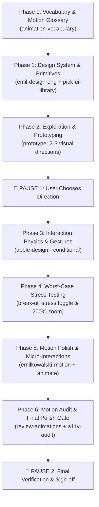

# UI Craft Pipeline — Master Plan

**Project:** Know Your Wait (`apps/site`)  
**Specification Sources:** `PRD.md`, `GLOSSARY.md`, `docs/adr/`, `docs/plan/`  
**Standard:** WCAG 2.2 AA, Emil Kowalski UI & Motion Craft, Apple Design physics

---

## 1. Objective & Product Guardrails

Know Your Wait is a free, independent site explaining official NHS waiting-time statistics for England, Wales, and Scotland in plain English.

### Non-Negotiable Core Principles (AGENTS.md & PRD)

1. **Never compare across nations** (ADR-0006): Independent nation paths (`/england`, `/wales`, `/scotland`). No cross-nation tables or combined charts.
2. **Never rank or sort by wait duration**: Reporting Units are listed alphabetically (England grouped by NHS Region, alphabetical within).
3. **Snapshots, not predictions** (ADR-0002): Figures describe people already waiting at a specific Reporting Period. Every figure carries the fixed caption.
4. **Never estimate** (ADR-0005): Official Figures or exact sums only. Suppressed figures render as _"Not published (small numbers)"_.
5. **Never sum Scotland's wait stages** (ADR-0002): Outpatient and inpatient/day case figures are distinct and never summed.
6. **No NHS branding** (ADR-0004): No NHS logo, blue lozenge `#005EB8`, or NHS fonts. Distinct, calm, accessible identity.
7. **Accessibility & Resilience**: WCAG 2.2 AA compliant ($\ge 4.5:1$ text contrast, $\ge 3:1$ UI contrast, $\ge 44\text{px}$ touch targets, visible `:focus-visible` rings). Works without JavaScript; all copy through `apps/site/src/i18n`.

---

## 2. Pipeline Architecture & Phases

### Phase Details & Exit Criteria

### Phase 0: Vocabulary & Motion Glossary (Reference)

- **Skill:** `~/.gemini/config/skills/animation-vocabulary/SKILL.md`
- **Scope:** Define all motion mechanics across the user journey (press feedback, accordion expansions, staggered entries, tabular numbers, origin-aware focus).
- **Exit Criteria:** Motion vocabulary documented in `ui-pipeline/HANDOFF.md` matching canonical Kowalski definitions.

### Phase 1: Design System & Primitives Selection

- **Skills:** `~/.gemini/config/skills/emil-design-eng/SKILL.md` + `~/.gemini/config/skills/pick-ui-library/SKILL.md`
- **Scope:**
  - Token architecture in Tailwind CSS v4 / CSS variables (spacing, radius hierarchy, layered shadows, high-contrast accessible color palette).
  - Select headless primitives (evaluating `@base-ui-components/react` vs native HTML).
- **Exit Criteria:** Design tokens and headless library documented in `ui-pipeline/HANDOFF.md` and configured in code.

### Phase 2: Exploration & Prototyping

- **Skill:** `~/.gemini/config/skills/prototype/SKILL.md`
- **Scope:** Build 2–3 distinct visual directions with an interactive switcher for the core flow (Nation $\rightarrow$ Specialty $\rightarrow$ Provider Figures).
- **Gate:** 🛑 PAUSE — Present screenshots and switcher; user selects winning direction. Clean up unchosen variants.

### Phase 3: Interaction Physics & Gestures (Conditional)

- **Skill:** `~/.gemini/config/skills/apple-design/SKILL.md`
- **Scope:** Apply 1:1 gesture tracking, momentum, and rubber-banding if direct manipulation exists (or log _"Skipped — no direct manipulation"_ if static).
- **Exit Criteria:** Gestures reversible/interruptible with full keyboard fallbacks.

### Phase 4: Worst-Case Stress Testing

- **Skill:** `~/.gemini/config/skills/break-ui/SKILL.md`
- **Scope:** Wire "Demo data / Worst-case" stress toggle with long strings, suppressed figures, 0 vs 1,000 items, and 200% zoom.
- **Exit Criteria:** Zero clipping, horizontal overflow, or broken layout.

### Phase 5: Motion Polish & Micro-Interactions

- **Skills:** `~/.gemini/config/skills/emilkowalski-motion/SKILL.md` + `~/.gemini/config/skills/animate/SKILL.md`
- **Scope:** Implement subtle press feedback (`active:scale-[0.98]`), ease-out reveals, origin-aware transitions, and strict `prefers-reduced-motion` fallbacks.
- **Exit Criteria:** $\le 300\text{ms}$ duration, 60fps GPU transforms/opacity only.

### Phase 6: Motion Audit & Final Polish Gate

- **Skills:** `~/.gemini/config/skills/review-animations/SKILL.md` + `~/.gemini/config/skills/emil-design-eng/SKILL.md` + `~/.gemini/config/skills/a11y-audit/SKILL.md`
- **Scope:** Run motion linting, generate Emil Kowalski Before/After table, run WCAG 2.2 AA audit.
- **Gate:** 🛑 PAUSE — Present final report, screenshots across viewports/modes, and completed `ui-pipeline/HANDOFF.md`.
